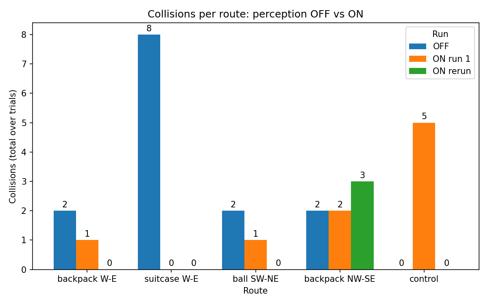
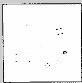

# Indoor Autonomous Robot — Perception-Aware Navigation in ROS 2

A simulated differential-drive robot that maps an indoor space, navigates to a goal
with Nav2, and uses camera-based object detection to avoid obstacles its LiDAR
cannot see.

> **Status: in development (Milestone 6 of 6).** The robot runs in Gazebo with
> a LiDAR, an RGB-D camera, an IMU and a contact sensor; `slam_toolbox` builds
> an occupancy grid map of the room; Nav2 with AMCL localizes on that map and
> reaches goals; and a fine-tuned single-class obstacle detector feeds a
> projector node that publishes `/perception/obstacle_cloud`, which is wired
> into both costmaps as a second observation source. An evaluation harness
> exists (trial runner, goals file, contact-sensor collision counts). The
> perception ON vs OFF experiments have been run; the write-up is in progress.

## The idea

A 2D LiDAR sees a single horizontal slice of the world. Anything below that plane —
a bag on the floor, a low stool, a cable tray — is invisible to it, and a robot
relying on LiDAR alone will drive straight into it.

This project puts a lightweight object detector on the robot's RGB-D camera,
projects each detection into 3D using the depth image, and publishes the result as a
point cloud that Nav2 consumes as a **second observation source** in its costmap. The
navigation stack then plans around obstacles it otherwise could not perceive.

The claim is testable, so it gets tested: the evaluation is an ablation over
identical trials with perception enabled and disabled.

## Architecture

```
Gazebo Harmonic
  ├─ 2D LiDAR ─────────────┐
  ├─ RGB-D camera ──┐      │
  ├─ IMU            │      │
  └─ contact sensor │      │   (ground-truth collisions, evaluation only)
        ↓ ros_gz_bridge     │
   ┌────┴──────────────┐    │
   │  detector_node    │    │   /perception/detections_2d
   │        ↓          │    │
   │  projector_node   │    │   /perception/detections_3d
   └────┬──────────────┘    │   /perception/obstacle_cloud
        │                   │
        └─────────┬─────────┘
          /scan ──┘  + /perception/obstacle_cloud
                  ↓
   Nav2 costmaps — obstacle layer, two observation sources:
   /scan (LiDAR) and /perception/obstacle_cloud
                  ↓
   AMCL on the saved map → map→odom transform
                  ↓
   Nav2: planner_server → controller_server → /cmd_vel
                  ↓
   trial_runner → CSV
```

The perception and navigation halves communicate only through the topics defined in
[`docs/INTERFACES.md`](docs/INTERFACES.md), which is a frozen contract rather than
documentation written after the fact. That decoupling is what lets the two halves be
developed independently.

## Stack

| Component | Choice |
|---|---|
| ROS 2 | Jazzy Jalisco (LTS) |
| Simulator | Gazebo Harmonic, headless |
| SLAM | `slam_toolbox` |
| Navigation | Nav2 — NavFn planner, DWB controller |
| Detection | Ultralytics YOLO11n, CPU inference |
| Visualisation | Foxglove via `foxglove_bridge` |
| Environment | Docker, arm64 |

Nothing that already exists in the ROS ecosystem is reimplemented. The work is the
robot description, the perception pipeline, the integration between them, and the
evaluation.

## Hardware constraints

Developed on an Apple Silicon MacBook (M2) inside a Docker container. No NVIDIA GPU
and no GPU passthrough to the container, so Gazebo renders camera images in software
and inference runs on CPU. The system is scoped to fit:

- Cameras at 320×240, 10 Hz, rather than 640×480, 15 Hz
- LiDAR at 180 samples, 5 m range
- Measured sensor rates under software rendering: LiDAR 9.74 Hz, colour image
  9.76 Hz, depth image 9.71 Hz (targets 10 Hz)
- A single ~8×8 m room
- DWB controller instead of MPPI, which samples too many trajectories to keep up
- `use_sim_time: true` throughout; time-to-goal is reported in **simulated** seconds
  with the real-time factor logged alongside it, and inference latency in wall-clock
  milliseconds with the hardware named

These are limits worked around deliberately, not defaults left unexamined.

## Results

Detection, held-out set of simulated frames:

Test split, 184 images, one room:

| Metric | Value |
|---|---|
| Precision (custom matching, conf 0.25, IoU 0.3) | 0.862 |
| Recall (custom matching, conf 0.25, IoU 0.3) | 0.973 |
| mAP@0.5 (`yolo val`) | 0.972 |
| mAP@0.5:0.95 (`yolo val`) | 0.875 |
| Inference latency, model only, p50 / p95 | 23.8 ms / 24.4 ms |
| Inference latency, inside the ROS node, p50 / p95 | 28.3 ms / 32.8 ms |

Collisions are counted from a Gazebo contact sensor on the robot base rather than
inferred from LiDAR ranges.

## Navigation results

10 trials per run: 5 routes, 2 repeats each, seed 1.

| Run | Success | Collisions (total) | Trials with a collision | Time to goal (s) | Path (m) | Recoveries |
|---|---|---|---|---|---|---|
| OFF (LiDAR only) | 10/10 | 14 | 8 | 10.3 ± 1.7 | 2.22 ± 0.31 | 0 |
| ON run 1 (preliminary) | 9/10 | 9 | 5 | 20.2 ± 17.8 | 2.96 ± 2.33 | 31 |
| ON rerun (clean) | 10/10 | 3 | 2 | 11.3 ± 1.9 | 2.32 ± 0.27 | 0 |

Time and path are mean ± standard deviation over successful trials only (ON
run 1 excludes the aborted trial 1).

Collisions per route (total over the 2 repeats):

| Run | backpack W-E | suitcase W-E | ball SW-NE | backpack NW-SE | control |
|---|---|---|---|---|---|
| OFF | 2 | 8 | 2 | 2 | 0 |
| ON run 1 | 1 | 0 | 1 | 2 | 5 |
| ON rerun | 0 | 0 | 0 | 3 | 0 |



*Collisions per route. The 5 on the control route in ON run 1 is trial 9, which
followed trial 8 (stuck against the backpack for most of its 52 s). The cause
is unexplained. A control-only ON check (5 trials) gave 0 collisions, and
trial 9 of the rerun, which also followed a trial 8 with a collision, had 0.*

## Findings

- With perception on, collisions fell from 14 to 3 in the clean rerun, mostly
  on the suitcase route (8 to 0).
- The backpack NW-SE route (passes 0.15 m from the backpack) did not improve:
  2 vs 3.
- ON run 1 had start-up trouble (the runner started before the detector and
  projector), one aborted trial (trial 1, 17 recoveries) and a stuck trial 8.
  The rerun fixed start-up by waiting for the perception cloud and adding a
  3 s pause between trials, and it did not reproduce the stuck trial. The
  cause of that run-to-run difference is unexplained.
- Perception costs about 1 s and 0.1 m per trial, and the simulator ran slower
  (real-time factor about 0.75-0.87 vs 0.95).
- The robot pitched 13.5 degrees until a front caster was added.
- Stock YOLO11n gave false positives and low scores on simulated frames, so a
  single-class detector was fine-tuned on simulator-labelled renders.
- The map shows walls and tall furniture but not the three objects below
  0.20 m, by design.
- Detector labels come from Gazebo's bounding-box camera.

## Limitations

- A single room, with one set of textures.
- Only static low objects.
- 10 trials over 5 routes with one seed, so the counts are suggestive, not
  statistically significant.
- Goal tolerance is 0.15 m.
- Collisions are counted by a Gazebo contact sensor with a 0.5 s debounce.
- The detector's recall on low objects was only evaluated offline.
- The simulation is software-rendered, on a CPU-only Mac in Docker.

## Demo



## Repository layout

```
src/
  indoor_bot_description/   robot URDF, sensors, frames
  indoor_bot_gazebo/        worlds, models, spawn and bridge launch
  indoor_bot_navigation/    Nav2 and slam_toolbox parameters, maps
  indoor_bot_bringup/       launch files: mapping, nav, teleop, experiment
  indoor_bot_perception/    detector and 3D projection nodes
  indoor_bot_interfaces/    custom messages and actions
  indoor_bot_evaluation/    trial_runner, config/goals.yaml, scripts
docs/
  INTERFACES.md             the contract between the two modules
  ARCHITECTURE.md           design decisions and trade-offs
  SETUP.md                  reproducible environment setup
  DEBUG_LOG.md              problems hit and how they were resolved
```

## Getting started

See [`docs/SETUP.md`](docs/SETUP.md). In short:

```bash
docker compose build
docker compose up -d
docker compose exec ros bash

cd /ws
colcon build --symlink-install
```

Dependency versions are pinned in `docs/requirements.txt`. Two of the pins are
load-bearing: `numpy<2`, because `cv_bridge` is compiled against numpy 1.x, and
`setuptools<80`, which `colcon-core` requires.

## Milestones

| | | Status |
|---|---|---|
| M0 | Workspace, interface contract, CI | done |
| M1 | Robot in simulation, sensors publishing | done |
| M2 | SLAM map, detector publishing detections | done |
| M3 | Autonomous navigation to a goal, 3D projection | done |
| M4 | Perception integrated into the costmap | done |
| M5 | Experiment runner and metrics logging | done |
| M6 | Experiments, analysis, write-up | in progress |

## Licence

AGPL-3.0, required by Ultralytics YOLO. Swapping the detector for
`torchvision`'s SSDLite would allow a permissive licence.